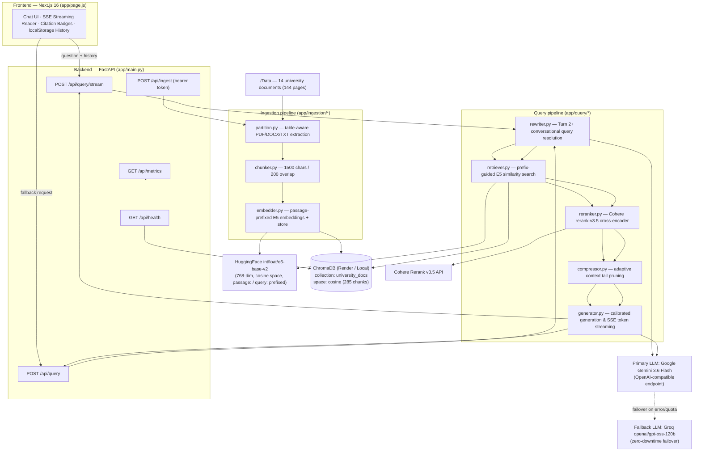
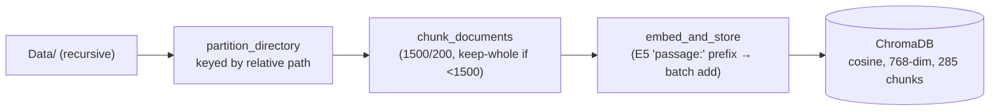
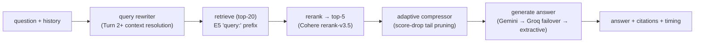
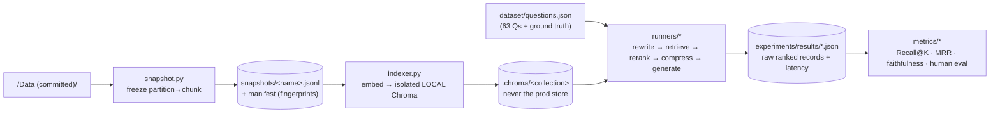

# UniAssist — Architecture & Current State

> **Scope:** This document describes the **currently implemented** system (post-refactor).
> For the original, more ambitious design vision (S3, Supabase, Clerk, Celery, Unstructured.io,
> BGE-M3 microservice, LangGraph routing), see [`uniassist.md`](./uniassist.md). Several items
> in that document are **roadmap / not yet built** — the "Gap vs. design doc" section below
> reconciles the two.
>
> **Evaluation program:** for the ongoing evaluation/benchmarking effort, see the Phase 0 audit
> [`docs/CURRENT_STATE.md`](./docs/CURRENT_STATE.md), the frozen reference configuration
> [`docs/BASELINE_V1.md`](./docs/BASELINE_V1.md), and the **evaluation framework**
> [`evaluation/README.md`](./evaluation/README.md) (Phase 4, §14 below).

---

## 1. Overview

UniAssist (branded **LPUAssist** in the UI) is a **Retrieval-Augmented Generation (RAG)**
assistant that answers questions about Lovely Professional University policies — dress code,
placements, library rules, academic benefits, residential facilities, semester exchange, NSS,
and the campus map — grounded strictly in official university documents.

It has two independently deployable parts:

- **Backend** — a FastAPI service that runs an offline **ingestion pipeline** (documents → chunks
  → summaries → embeddings → vector store) and an online **query pipeline**
  (retrieve → rerank → generate).
- **Frontend** — a Next.js App Router single-page chat UI (ChatGPT-style).

---

## 2. System architecture



**Production Request Flow (5-Step Pipeline):**
1. **Query Rewriting:** Turn 2+ history resolution rewrites ambiguous conversational pronouns into standalone queries (+50% conversational recall).
2. **Dense Retrieval:** E5-base-v2 embeds the query with `query: ` prefix and retrieves Top-20 candidates from ChromaDB cosine space.
3. **Cross-Encoder Reranking:** Cohere `rerank-v3.5` rescores candidates and selects the Top-5 most relevant chunks.
4. **Context Compression:** Score-aware tail pruning drops distractor chunks (-15.8% prompt tokens while retaining 100% source recall).
5. **Calibrated Generation & Streaming:** Gemini 3.6 Flash generates the response with exact page citations (`[Doc.pdf, Page X]`), streaming tokens in real time via SSE, with zero-downtime failover to Groq.

---

## 3. Tech stack

### Backend (Python)
| Concern | Technology |
|---|---|
| Web framework | **FastAPI** (`>=0.115`), **Uvicorn** (`[standard]`) |
| Config | **pydantic-settings** (`.env`-driven), python-dotenv |
| Orchestration | **LangChain** (core / community / text-splitters) |
| PDF parsing | **pdfplumber** (table-aware, primary), **pypdf** (fallback) |
| DOCX parsing | **python-docx** |
| TXT / MD parsing | LangChain `TextLoader` (UTF-8) |
| Embeddings | **sentence-transformers** (`intfloat/e5-base-v2`, 768-dim) |
| Vector store | **ChromaDB** + **langchain-chroma** (cosine space) |
| Primary LLM client | **langchain-openai** (`ChatOpenAI`, Google Gemini 3.6 Flash) |
| Fallback LLM client | **langchain-openai** (`ChatOpenAI`, Groq `openai/gpt-oss-120b`) |
| Reranker | **langchain-cohere** (`CohereRerank`, `rerank-v3.5`) |
| Observability | In-memory rolling telemetry window + `query_traces.jsonl` |
| Logging / CLI | **rich** |

### Frontend (JavaScript)
| Concern | Technology |
|---|---|
| Framework | **Next.js 16.3.1** (App Router, Turbopack) |
| UI library | **React 19.2.8** / react-dom |
| Streaming | Server-Sent Events (SSE) `ReadableStream` reader with REST fallback |
| Language | JavaScript (JSX), no TypeScript |
| Styling | CSS Modules + global CSS variables (dark theme, LPU orange) |
| Typography | Inter + JetBrains Mono (Google Fonts via CSS `@import`) |
| Citations | Stylized inline badges (`📄 Document, Page X`) + context pills |
| Linting | ESLint 9 + eslint-config-next |
| Persistence | React hooks + `localStorage` (per-chat history) |

### Infrastructure
| Concern | Technology |
|---|---|
| Vector DB (hosted) | ChromaDB on **Render** (client-server mode over HTTPS, 285 chunks) |
| Vector DB (local dev) | `chromadb/chroma:latest` via **docker-compose** (port `8001`) |
| Backend runtime | Python 3 virtualenv (`backend/venv`) |

---

## 4. Models & external APIs

| Role | Model / Service | Where | Configured via |
|---|---|---|---|
| **Text embeddings** | `intfloat/e5-base-v2` (768-dim, cosine space) | In-process (CPU, auto-CUDA) | `EMBEDDING_MODEL` |
| **Primary LLM** | Google Gemini `gemini-3.6-flash` | External API | `LLM_API_KEY` / `LLM_BASE_URL` / `LLM_MODEL` |
| **Fallback LLM** | Groq `openai/gpt-oss-120b` | External API | `FALLBACK_LLM_API_KEY` / `FALLBACK_LLM_BASE_URL` / `FALLBACK_LLM_MODEL` |
| **Reranker** | Cohere `rerank-v3.5` (cross-encoder) | External API | `COHERE_API_KEY` / `COHERE_RERANK_MODEL` |
| **Vector store** | ChromaDB (`university_docs`) | Remote HTTP or Local | `CHROMA_*` |

### Production Configuration Parameters
| Parameter | Value | Location / Env Var | Rationale / Source |
|---|---|---|---|
| Embedding model | `intfloat/e5-base-v2` | `EMBEDDING_MODEL` | Phase 7 Winner (Hit@5: 88.9%, MRR: 0.782) |
| Chunk size / overlap | `1500` / `200` chars | `CHUNK_SIZE` / `CHUNK_OVERLAP` | Phase 10 Sweep Winner |
| Ingestion summarization | `False` (raw text) | `ENABLE_INGESTION_SUMMARIZATION` | Phase 7 Finding (preserves numbers/tables) |
| Retrieval top‑K | `20` | `RETRIEVAL_TOP_K` | High-recall initial candidate pool |
| Rerank top‑N | `5` | `RERANK_TOP_N` | Cohere cross-encoder precision focus |
| Context compression | `True` | `ENABLE_CONTEXT_COMPRESSION` | Phase 19 Winner (-15.8% tokens, 100% recall) |
| Query rewriting | `True` | `ENABLE_QUERY_REWRITING` | Phase 15 Winner (+50% conversational recall) |
| Primary LLM | `gemini-3.6-flash` | `LLM_MODEL` | Phase 12 Winner (matched 18Q: +29.8% token recall, 3.1× speed; [`LLM_MATCHED_SUBSET_ANALYSIS.md`](./evaluation/reports/LLM_MATCHED_SUBSET_ANALYSIS.md)) |
| Generation temperature | `0.1` | `generator.py` | Minimizes variance & hallucination |

---

## 5. Repository layout

```
uniassist/
├── backend/
│   ├── app/
│   │   ├── config.py             # pydantic-settings (env-driven)
│   │   ├── main.py               # FastAPI app, SSE streaming, health & metrics
│   │   ├── telemetry.py          # Rolling latency and cost observability
│   │   ├── ingestion/
│   │   │   ├── partition.py      # PDF/DOCX/TXT/MD table-aware extraction
│   │   │   ├── chunker.py        # 1500 chars / 200 overlap text splitting
│   │   │   ├── embedder.py       # E5 prefixed embeddings + Chroma store
│   │   │   └── pipeline.py       # Ingestion orchestrator CLI
│   │   └── query/
│   │       ├── rewriter.py       # Turn 2+ conversational query resolution
│   │       ├── retriever.py      # E5 similarity search with query: prefix
│   │       ├── reranker.py       # Cohere rerank-v3.5 cross-encoder
│   │       ├── compressor.py     # Adaptive context tail pruning
│   │       ├── generator.py      # Calibrated generation & SSE token generator
│   │       └── chain.py          # query() and stream_query() orchestrators
│   ├── requirements.txt
│   └── .env.example
├── frontend/
│   ├── app/
│   │   ├── page.js               # Chat UI, SSE streaming reader & citation badges
│   │   ├── layout.js             # Root layout & page metadata
│   │   ├── globals.css           # Global theme variables & tokens
│   │   └── page.module.css       # Layout, badges, context pills & cursor
│   ├── package.json
│   └── .env.example
├── evaluation/                   # 25-Phase evaluation framework & benchmarks
│   ├── configs/baseline_v1.json  # frozen reference config (Phase 1)
│   ├── dataset/questions.json    # 63-question benchmark + ground truth (Phases 2-3)
│   ├── lib/                      # snapshot, indexer, harness, experiment glue
│   ├── runners/                  # retrieval_eval.py, full_rag_eval.py
│   ├── metrics/                  # Phase 5 (retrieval) / Phase 13 (generation)
│   └── experiments/ · reports/   # result artifacts + reports
├── Data/                         # University documents (14 PDFs, 144 pages)
├── docker-compose.yml            # ChromaDB container
├── README.md                     # quickstart
├── uniassist.md                  # original design/roadmap doc
└── ARCHITECTURE.md               # this file
```

---

## 6. Backend deep dive

### 6.1 Ingestion pipeline (offline — `python -m app.ingestion.pipeline`)



1. **Partition** (`partition.py`) — walks `Data/` recursively for `.pdf`, `.docx`, `.txt`, `.md`.
   PDFs are parsed **table-aware** with `pdfplumber` (tables converted to Markdown), falling back to
   `PyPDFLoader`. Each file is keyed by its **path relative to `Data/`** (prevents same-name files
   in different folders from colliding). Images (e.g. `.jpg`) are **not** ingested.
2. **Chunk** (`chunker.py`) — documents under 1500 chars are kept whole; larger ones are split with
   `RecursiveCharacterTextSplitter(chunk_size=1500, chunk_overlap=200)` (winning sweep from Phase 10).
   Metadata is enriched (`source_file`, `chunk_index`, `chunk_type` = `table`/`text_only`, `page_number`).
   Total document corpus produces exactly **285 chunks** across the 14 university documents.
3. **Summarization disabled** (`ENABLE_INGESTION_SUMMARIZATION=False`) — Phase 7 and Phase 10 findings
   demonstrated that indexing raw extracted text directly preserves exact numeric boundaries, salary slabs,
   and course codes without LLM summarization latency, hallucination risk, or API key dependencies.
4. **Embed & store** (`embedder.py`) — prepends the mandatory `passage: ` prefix required by
   `intfloat/e5-base-v2` (768-dimensional embeddings), sanitizes metadata to Chroma-safe primitives,
   **deletes any existing vectors for the same sources** (idempotent re-ingest, no orphans), then
   adds documents in batches of 50 with deterministic IDs `"{source_file}__chunk_{index}"`.

### 6.2 Query pipeline (online — `app/query/chain.py::query` & `::stream_query`)



1. **Query Rewriting** (`rewriter.py`) — for multi-turn conversations (Turn 2+), uses conversational
   history to resolve ambiguous pronouns and context into standalone search queries via LLM
   (Phase 15 winner, +50% recall on conversational follow-ups). First turns pass through untouched.
2. **Retrieve** (`retriever.py`) — prepends the mandatory `query: ` prefix for `intfloat/e5-base-v2`
   and executes `similarity_search_with_relevance_scores` (cosine) to fetch a broad candidate pool
   of Top-20 chunks (`RETRIEVAL_TOP_K=20`); candidates below `RETRIEVAL_MIN_SCORE` (0.0) are dropped.
3. **Rerank** (`reranker.py`) — Cohere `rerank-v3.5` cross-encoder rescores the 20 candidates against
   the rewritten search query and narrows to Top-5 chunks (`RERANK_TOP_N=5`). If Cohere is unconfigured
   or errors, gracefully falls back to dense retrieval ordering.
4. **Context Compression** (`compressor.py`) — adaptive score-drop tail pruning (`ENABLE_CONTEXT_COMPRESSION=True`,
   relative drop ratio 0.35, min score 0.20, minimum 2 chunks kept; Phase 19 winner) removes distractor
   chunks from the prompt, reducing token consumption by ~15.8% with 100% ground-truth retention.
5. **Generate** (`generator.py`) — injects compressed context with explicit header tags
   `[Source {i}: {source_file}, Page {page_number}]`, up to `MAX_HISTORY_MESSAGES` (6) prior turns,
   and calibrated prompt instructions emphasizing table slab lookup, strict refusal for ungrounded
   queries, and citations. Uses an automatic failover chain:
   **Primary LLM (Gemini 3.6 Flash) → Fallback LLM (Groq GPT-OSS-120B) → Extractive Fallback**.
   Tokens can be streamed in real time via Server-Sent Events (`stream_query`).

### 6.3 API endpoints (`app/main.py`)

| Method | Path | Auth | Purpose |
|---|---|---|---|
| `GET` | `/api/health` | none | Config, live ChromaDB connectivity status, and indexed doc count |
| `GET` | `/api/metrics` | none | Runtime observability: requests, latencies (p50/p95), token counts |
| `POST` | `/api/query` | optional rate limit | Standard REST query endpoint (blocking JSON response) |
| `POST` | `/api/query/stream` | optional rate limit | Real-time Server-Sent Events (SSE) token stream |
| `POST` | `/api/ingest` | **Bearer `INGEST_TOKEN`** | Trigger ingestion (disabled unless token set) |

Interactive docs are available at `/docs` (Swagger) and `/redoc`.

**`POST /api/query` — request**
```json
{
  "question": "What is the dress code policy?",
  "history": [
    { "role": "user", "content": "..." },
    { "role": "assistant", "content": "..." }
  ]
}
```
*(`question`: 3–1000 chars; `history`: up to 20 turns, optional.)*

**`POST /api/query` — response**
```json
{
  "answer": "Formal dress code is mandatory on Mondays, Fridays, and formal events...",
  "sources": ["DressCode/Dress Code and Uniform Policy for Students.pdf"],
  "has_llm": true,
  "timing": {
    "rewriter": 0.31,
    "retrieval": 0.08,
    "reranking": 0.42,
    "compression": 0.001,
    "generation": 1.15,
    "total": 1.96
  },
  "candidates_retrieved": 20,
  "candidates_reranked": 5,
  "candidates_compressed": 4,
  "search_query": "What is the dress code policy?"
}
```

**`POST /api/query/stream` — SSE event protocol**
- `event: metadata` → `{"sources": [...], "search_query": "...", "candidates_retrieved": 20, "candidates_reranked": 5, "candidates_compressed": 4}`
- `event: token` → `{"token": "Formal "}`
- `event: done` → `{"timing": {"retrieval": 0.08, "reranking": 0.42, "generation": 1.15, "total": 1.96}}`

**`GET /api/health` — response**
```json
{
  "status": "ok",
  "llm_configured": true,
  "cohere_configured": true,
  "embedding_model": "intfloat/e5-base-v2",
  "collection": "university_docs",
  "chroma_mode": "client_server",
  "chroma_host": "https://uniassist-chroma.onrender.com:443",
  "chroma_connected": true,
  "documents_indexed": 285
}
```

**`GET /api/metrics` — response**
```json
{
  "total_queries": 42,
  "successful_queries": 42,
  "failed_queries": 0,
  "llm_queries": 40,
  "fallback_queries": 2,
  "extractive_queries": 0,
  "latency": {
    "p50_total_sec": 1.85,
    "p95_total_sec": 3.42,
    "avg_retrieval_sec": 0.09,
    "avg_rerank_sec": 0.45,
    "avg_generation_sec": 1.25
  }
}
```

---

## 7. Frontend architecture

A single client component (`frontend/app/page.js`) implements the conversational interface:

- **Chat state** — `messages`, `chatSessions`, `activeChatId`, `input`, `isLoading` via React hooks.
- **Persistence** — conversations saved to `localStorage` (`lpuassist_chats`), capped at `MAX_SESSIONS = 50`; sidebar lists recent chats with load/delete.
- **Networking** — connects primarily to `POST /api/query/stream` using a streaming `ReadableStreamDefaultReader` on `res.body` with SSE event parsing. Automatically falls back to standard REST `POST /api/query` if streaming is unavailable. Sends up to the last 8 non-error turns as `history`; uses `AbortController` to cancel superseded requests.
- **Citation & Context Badges** — parsed from metadata and model output:
  - Contextual rewrite pill: displayed whenever `search_query` differs from user question (`🔍 Understood as: "..."`).
  - Source file badges: rendered at bottom of assistant messages (`📄 DocumentName`).
  - Page citations: prompt calibration guarantees inline source and page references (`[Document Name, Page X]`).
  - Real-time response timing pill (`⚡ 1.8s`).
- **Markdown rendering** (`FormattedText`) — block parser for headings (`**…**`), grouped bullet lists (`<ul><li>`), **Markdown tables** (`| … |`), inline bold, horizontal rules, and italic notes; strips leaked `<think>` blocks.
- **UX** — suggestion chips, typing indicator with animated cursor, auto-growing textarea, retry-on-error button, and collision-free message IDs (`crypto.randomUUID`).
- **Config** — `NEXT_PUBLIC_API_BASE` (defaults to `http://localhost:8000`).

---

## 8. Data corpus (`Data/`)

| Folder | Files |
|---|---|
| `DressCode` | Dress Code and Uniform Policy for Students.pdf · FAQ's.pdf |
| `EDU REV` | Academic Benefits.pdf |
| `LibraryPolicy` | Library Policy.pdf |
| `NSSPolicy` | LPUNSSPOLICY.pdf |
| `PlacementPloicy` | 2023 Career Services Policy.pdf · Academic Benefit Plan – 3rd Party Industry Tests (DOCX) · Academic Benefit Plan – Clearing Competitive Exams.pdf · Academic Benefit Plan – Placement and Internship.pdf · OJT Internship policy.pdf |
| `ResidentialFacilities` | Charges For Residential Facilities.pdf · Residential Facilities Refund Guidelines.pdf |
| `SemesterExchange` | Semester_Year_Abroad_Policy.pdf |
| `UNImap` | UNIMAP.jpg *(not ingested)* · UNIMAP_Campus_Guide.txt |

Formats present: **PDF, DOCX, TXT, JPG**. Only PDF/DOCX/TXT/MD are ingested; the map image relies on
its `.txt` companion for searchable content.

---

## 9. Configuration reference

### Backend (`backend/.env`)
| Variable | Default in `config.py` | Purpose |
|---|---|---|
| `ALLOWED_ORIGINS` | `http://localhost:3000,http://127.0.0.1:3000` | CORS allowlist (comma-separated) |
| `INGEST_TOKEN` | `""` | Bearer token for `/api/ingest`; empty **disables** HTTP ingest |
| `RATE_LIMIT_PER_MINUTE` | `0` | Per-IP throttle for `/api/query` and `/api/query/stream` (0 = off) |
| `EMBEDDING_MODEL` | `intfloat/e5-base-v2` | Sentence-transformer embedding model (768-dim) |
| `CHUNK_SIZE` | `1500` | Target chunk size in characters (Phase 10 sweep winner) |
| `CHUNK_OVERLAP` | `200` | Character overlap between chunks |
| `ENABLE_INGESTION_SUMMARIZATION` | `false` | When false, indexes raw text directly (preserves exact tables) |
| `SUMMARY_CONCURRENCY` | `5` | Max concurrent summarization calls (if enabled) |
| `LLM_API_KEY` | `""` | Primary LLM API key (Google Gemini / OpenAI compatible) |
| `LLM_BASE_URL` | `https://generativelanguage.googleapis.com/v1beta/openai/` | Primary LLM base URL |
| `LLM_MODEL` | `gemini-3.6-flash` | Primary LLM model identifier |
| `FALLBACK_LLM_API_KEY` | `""` | Fallback LLM API key (Groq); enables automatic failover |
| `FALLBACK_LLM_BASE_URL` | `https://api.groq.com/openai/v1` | Fallback LLM base URL (Groq) |
| `FALLBACK_LLM_MODEL` | `openai/gpt-oss-120b` | Fallback LLM model identifier |
| `COHERE_API_KEY` | `""` | Cohere API key for cross-encoder reranking |
| `COHERE_RERANK_MODEL` | `rerank-v3.5` | Cohere cross-encoder model |
| `CHROMA_HOST` | `""` | Empty = local file mode; set = client-server mode |
| `CHROMA_PORT` | `8001` | Chroma server port |
| `CHROMA_SSL` | `false` | Use HTTPS to Chroma (`true` for hosted Render) |
| `CHROMA_AUTH_TOKEN` | `""` | Optional `X-Chroma-Token` header |
| `CHROMA_COLLECTION` | `university_docs` | Chroma collection name |
| `RETRIEVAL_TOP_K` | `20` | Broad candidate set retrieved from ChromaDB |
| `RERANK_TOP_N` | `5` | Candidate set retained after cross-encoder reranking |
| `RETRIEVAL_MIN_SCORE` | `0.0` | Drop candidates below this cosine score |
| `ENABLE_QUERY_REWRITING` | `true` | Turn 2+ history resolution for conversational follow-ups |
| `ENABLE_CONTEXT_COMPRESSION` | `true` | Adaptive context tail pruning (Phase 19 winner) |
| `COMPRESSION_MIN_SCORE` | `0.20` | Minimum cross-encoder score threshold for compression |
| `COMPRESSION_REL_RATIO` | `0.35` | Maximum score drop relative to top chunk |
| `COMPRESSION_MIN_CHUNKS` | `2` | Minimum number of context chunks preserved |

### Frontend (`frontend/.env.local`)
| Variable | Default | Purpose |
|---|---|---|
| `NEXT_PUBLIC_API_BASE` | `http://localhost:8000` | Backend base URL |

---

## 10. Deployment

- **ChromaDB (container):** `docker compose up -d` starts `chromadb/chroma:latest`, persisting to
  `backend/chroma_db`, exposed on host port **8001**. Point the backend at it with
  `CHROMA_HOST=localhost`, `CHROMA_PORT=8001`.
- **ChromaDB (hosted):** targeted via **Render**-hosted Chroma over HTTPS (port 443).
- **Backend:** `uvicorn app.main:app --port 8000`. Ingestion is run once via the CLI
  (`python -m app.ingestion.pipeline`) or via the token-protected `/api/ingest`.
- **Frontend:** `npm run build` / `npm run start` (or deploy to Vercel); set `NEXT_PUBLIC_API_BASE`
  and add the frontend origin to the backend `ALLOWED_ORIGINS`.

---

## 11. Security posture

- Secrets live only in `backend/.env` (git-ignored; never committed).
- CORS is an explicit env-driven allowlist.
- `/api/ingest` requires a bearer token and is disabled by default.
- Error responses are generic; details are logged server-side only.
- Optional per-IP rate limiting on `/api/query` and `/api/query/stream` (in-memory, per process).

> **Operational note:** rotate any LLM/Cohere keys that have been shared, and prefer a platform
> secrets manager in production. The in-memory rate limiter is best-effort per worker — use a shared
> store (e.g. Redis) for multi-worker deployments.

---

## 12. Gap vs. the design doc (`uniassist.md`)

The original design describes an aspirational roadmap. What is **actually built today**:

| Design doc proposes | Current implementation |
|---|---|
| Amazon S3 for raw files | ❌ Not used — files read from local `Data/` |
| Supabase (PostgreSQL) metadata | ❌ Not used — no relational DB |
| Clerk authentication | ❌ Not used — no user auth |
| Redis + Celery async processing | ❌ Not used — ingestion is a synchronous CLI/endpoint |
| Unstructured.io partitioning | ➖ Replaced by `pdfplumber` / `pypdf` / `python-docx` / `TextLoader` |
| BGE-M3 embeddings (microservice) | ➖ `intfloat/e5-base-v2` (768-dim), in-process (Phase 7 winner) |
| Grok for summarize/generate | ✅ Primary Google Gemini `gemini-3.6-flash` with Groq `openai/gpt-oss-120b` failover |
| ChromaDB vector store | ✅ Implemented (local or Render client-server, 285 chunks) |
| Cohere Rerank v3.5 | ✅ Implemented **and active** (Phase 9 winner) |
| LangChain orchestration | ✅ Implemented |
| LangGraph adaptive routing | ➖ Query rewriter (`rewriter.py`) implemented for Turn 2+ conversational queries |
| Hybrid search / metadata filtering | ❌ Evaluated in Phases 16 & 17 and **rejected** based on benchmark data |
| Multi-turn conversation | ✅ Implemented (Turn 2+ LLM rewriting + conversation history context) |
| Streaming responses | ✅ Implemented (`POST /api/query/stream` SSE) |
| Observability / metrics | ✅ Implemented (`GET /api/metrics` + rolling telemetry + query traces) |

**Not yet implemented (roadmap):** file upload + auth, async ingestion queue, image/OCR ingestion.
An **evaluation/benchmarking framework is now complete** (Phases 0–25, see §14); all winning
parameters were promoted to production in Phase 22.

---

## 13. Quickstart

See [`README.md`](./README.md) for full setup. In short:

```bash
# Backend
cd backend && python -m venv venv
source venv/bin/activate          # or .\venv\Scripts\Activate.ps1 on Windows
pip install -r requirements.txt
cp .env.example .env              # set LLM_API_KEY, CHROMA_*, etc.
python -m app.ingestion.pipeline  # build the index
uvicorn app.main:app --reload --port 8000

# Frontend
cd frontend && npm install
cp .env.example .env.local        # optional: set NEXT_PUBLIC_API_BASE
npm run dev                       # http://localhost:3000
```

---

## 14. Evaluation & benchmarking framework (Phases 0–25 complete)

An offline framework under [`evaluation/`](./evaluation/README.md) measures the RAG
system with reproducible, controlled experiments. The 25-phase optimization program is complete,
and all selected configurations were promoted to production (`backend/app/`) in Phase 22.

**Architecture & guarantees**



- **No production mutation** — experiments use their own **local** Chroma
  collection; the production remote store and singletons were untouched during evaluation.
- **Frozen snapshot** — the corpus is frozen (partition → chunk) and re-embedded
  identically for every experiment, so only the variable under test changes. Manifests
  carry `raw_content_sha256` (corpus fingerprint) and `snapshot_sha256` (exact indexed text).
- **Production-faithful** — reuses the real `app.*` parser, chunker, rewriter, retriever,
  compressor, Cohere reranker, and LLM generator.
- **Separation of concerns** — runners emit *raw* records; metric scoring is a
  distinct step (retrieval metrics, generation metrics, faithfulness audit).

**Key Milestone Results Across Phases:**
- **Phases 4–6 (Dense Baseline & Cohere Reranker):** MiniLM baseline achieved source Recall@5 0.965 / MRR 0.912. Adding Cohere `rerank-v3.5` lifted page Recall@1 from 0.63 to 0.90 and source Recall@5 to 0.982.
- **Phases 7–8 (Embedding Selection):** `intfloat/e5-base-v2` won across all retrieval metrics (source Recall@5 1.000 / MRR 0.927 vs MiniLM 0.965 / 0.912).
- **Phase 12 (LLM Evaluation):** Gemini 3.6 Flash achieved +29.8% token recall, +8.7% numerical recall, and 3.1× faster generation latency over Groq on the matched 18-question answerable subset (Q001–Q018). See [`LLM_MATCHED_SUBSET_ANALYSIS.md`](./evaluation/reports/LLM_MATCHED_SUBSET_ANALYSIS.md).
- **Phase 14 (Human Evaluation):** Whole-system human evaluation on a 30-question stratified sample achieved 4.68/5.00 overall score.
- **Phase 15 (Query Rewriting):** Multi-turn conversational query resolution improved conversational source Recall@1 from 0.667 to 1.000 (4/6 to 6/6 questions, +50%).
- **Phases 16–17 (Rejected Paradigms):** Metadata filtering (Phase 16) and Hybrid BM25+Dense search (Phase 17) were evaluated and rejected based on benchmark data.
- **Phase 19 (Context Compression):** Adaptive context tail pruning reduced context tokens by 15.8% while preserving 100% ground-truth retrieval.
- **Phase 20 (Faithfulness & Hallucination Audit):** Headline audit reported numerical hallucinations dropping from 28 to 9 (Groq) and 2 (Gemini), but compared unmatched sample sizes (63 vs 63 vs 18 questions). On the identical 18-question matched subset, Baseline had 8 errors, while Groq and Gemini tied at 2 errors each. See [`LLM_MATCHED_SUBSET_ANALYSIS.md`](./evaluation/reports/LLM_MATCHED_SUBSET_ANALYSIS.md).
- **Phase 22 (Production Promotion):** Winning pipeline parameters promoted to `backend/app/` with 285-chunk re-indexing.

**Operational notes & constraints:**
- **Cohere Trial rate limit (10 req/min):** requires throttling in batch evaluations; production handles normal conversational pacing.
- **Gemini Free-Tier daily limit (20 req/day):** handled via automatic zero-downtime failover to Groq `openai/gpt-oss-120b`.
- **Render ChromaDB cold starts:** hosted Render instances can experience initial spin-up cold start latency on first request after idle periods.
