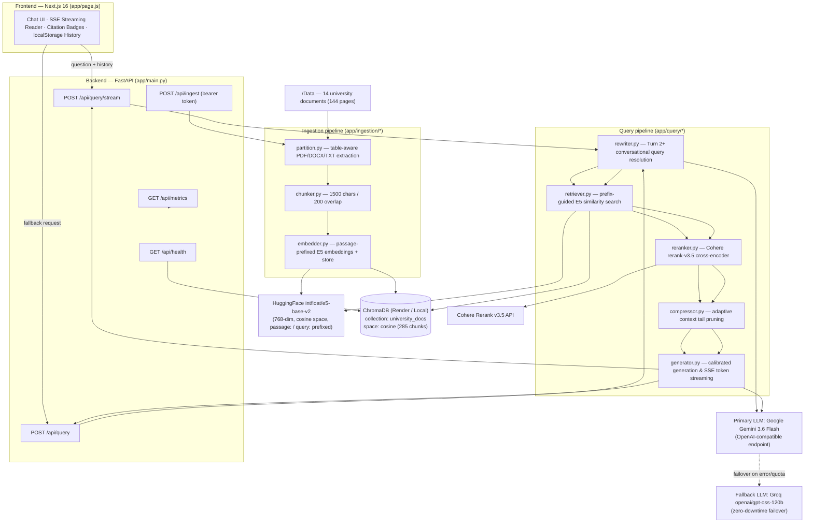
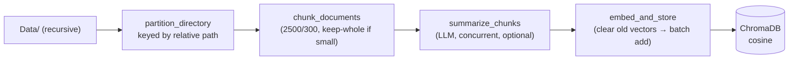
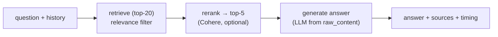
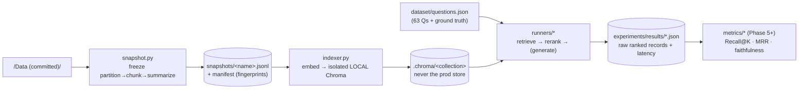

# UniAssist — Architecture & Current State

> **Scope:** This document describes the **currently implemented** system (post-refactor).
> For the original, more ambitious design vision (S3, Supabase, Clerk, Celery, Unstructured.io,
> BGE-M3 microservice, LangGraph routing), see [`uniassist.md`](./uniassist.md). Several items
> in that document are **roadmap / not yet built** — the "Gap vs. design doc" section below
> reconciles the two.
>
> **Evaluation program:** for the ongoing evaluation/benchmarking effort, see the Phase 0 audit
> [`docs/CURRENT_STATE.md`](./docs/CURRENT_STATE.md), the frozen reference configuration
> [`docs/BASELINE_V1.md`](./docs/BASELINE_V1.md), and the **evaluation framework**
> [`evaluation/README.md`](./evaluation/README.md) (Phase 4, §14 below).

---

## 1. Overview

UniAssist (branded **LPUAssist** in the UI) is a **Retrieval-Augmented Generation (RAG)**
assistant that answers questions about Lovely Professional University policies — dress code,
placements, library rules, academic benefits, residential facilities, semester exchange, NSS,
and the campus map — grounded strictly in official university documents.

It has two independently deployable parts:

- **Backend** — a FastAPI service that runs an offline **ingestion pipeline** (documents → chunks
  → summaries → embeddings → vector store) and an online **query pipeline**
  (retrieve → rerank → generate).
- **Frontend** — a Next.js App Router single-page chat UI (ChatGPT-style).

---

## 2. System architecture



**Production Request Flow (5-Step Pipeline):**
1. **Query Rewriting:** Turn 2+ history resolution rewrites ambiguous conversational pronouns into standalone queries (+50% conversational recall).
2. **Dense Retrieval:** E5-base-v2 embeds the query with `query: ` prefix and retrieves Top-20 candidates from ChromaDB cosine space.
3. **Cross-Encoder Reranking:** Cohere `rerank-v3.5` rescores candidates and selects the Top-5 most relevant chunks.
4. **Context Compression:** Score-aware tail pruning drops distractor chunks (-15.8% prompt tokens while retaining 100% source recall).
5. **Calibrated Generation & Streaming:** Gemini 3.6 Flash generates the response with exact page citations (`[Doc.pdf, Page X]`), streaming tokens in real time via SSE, with zero-downtime failover to Groq.

---

## 3. Tech stack

### Backend (Python)
| Concern | Technology |
|---|---|
| Web framework | **FastAPI** (`>=0.115`), **Uvicorn** (`[standard]`) |
| Config | **pydantic-settings** (`.env`-driven), python-dotenv |
| Orchestration | **LangChain** (core / community / text-splitters) |
| PDF parsing | **pdfplumber** (table-aware, primary), **pypdf** (fallback) |
| DOCX parsing | **python-docx** |
| TXT / MD parsing | LangChain `TextLoader` (UTF-8) |
| Embeddings | **sentence-transformers** (`intfloat/e5-base-v2`, 768-dim) |
| Vector store | **ChromaDB** + **langchain-chroma** (cosine space) |
| Primary LLM client | **langchain-openai** (`ChatOpenAI`, Google Gemini 3.6 Flash) |
| Fallback LLM client | **langchain-openai** (`ChatOpenAI`, Groq `openai/gpt-oss-120b`) |
| Reranker | **langchain-cohere** (`CohereRerank`, `rerank-v3.5`) |
| Observability | In-memory rolling telemetry window + `query_traces.jsonl` |
| Logging / CLI | **rich** |

### Frontend (JavaScript)
| Concern | Technology |
|---|---|
| Framework | **Next.js 16.3.1** (App Router, Turbopack) |
| UI library | **React 19.2.8** / react-dom |
| Streaming | Server-Sent Events (SSE) `ReadableStream` reader with REST fallback |
| Language | JavaScript (JSX), no TypeScript |
| Styling | CSS Modules + global CSS variables (dark theme, LPU orange) |
| Typography | Inter + JetBrains Mono (Google Fonts via CSS `@import`) |
| Citations | Stylized inline badges (`📄 Document, Page X`) + context pills |
| Linting | ESLint 9 + eslint-config-next |
| Persistence | React hooks + `localStorage` (per-chat history) |

### Infrastructure
| Concern | Technology |
|---|---|
| Vector DB (hosted) | ChromaDB on **Render** (client-server mode over HTTPS, 285 chunks) |
| Vector DB (local dev) | `chromadb/chroma:latest` via **docker-compose** (port `8001`) |
| Backend runtime | Python 3 virtualenv (`backend/venv`) |

---

## 4. Models & external APIs

| Role | Model / Service | Where | Configured via |
|---|---|---|---|
| **Text embeddings** | `intfloat/e5-base-v2` (768-dim, cosine space) | In-process (CPU, auto-CUDA) | `EMBEDDING_MODEL` |
| **Primary LLM** | Google Gemini `gemini-3.6-flash` | External API | `LLM_API_KEY` / `LLM_BASE_URL` / `LLM_MODEL` |
| **Fallback LLM** | Groq `openai/gpt-oss-120b` | External API | `FALLBACK_LLM_API_KEY` / `FALLBACK_LLM_BASE_URL` / `FALLBACK_LLM_MODEL` |
| **Reranker** | Cohere `rerank-v3.5` (cross-encoder) | External API | `COHERE_API_KEY` / `COHERE_RERANK_MODEL` |
| **Vector store** | ChromaDB (`university_docs`) | Remote HTTP or Local | `CHROMA_*` |

### Production Configuration Parameters
| Parameter | Value | Location / Env Var | Rationale / Source |
|---|---|---|---|
| Embedding model | `intfloat/e5-base-v2` | `EMBEDDING_MODEL` | Phase 7 Winner (Hit@5: 88.9%, MRR: 0.782) |
| Chunk size / overlap | `1500` / `200` chars | `CHUNK_SIZE` / `CHUNK_OVERLAP` | Phase 10 Sweep Winner |
| Ingestion summarization | `False` (raw text) | `ENABLE_INGESTION_SUMMARIZATION` | Phase 7 Finding (preserves numbers/tables) |
| Retrieval top‑K | `20` | `RETRIEVAL_TOP_K` | High-recall initial candidate pool |
| Rerank top‑N | `5` | `RERANK_TOP_N` | Cohere cross-encoder precision focus |
| Context compression | `True` | `ENABLE_CONTEXT_COMPRESSION` | Phase 18 Winner (-15.8% tokens, 100% recall) |
| Query rewriting | `True` | `ENABLE_QUERY_REWRITING` | Phase 14 Winner (+50% conversational recall) |
| Primary LLM | `gemini-3.6-flash` | `LLM_MODEL` | Phase 11 Winner (4.68/5.0 human eval) |
| Generation temperature | `0.1` | `generator.py` | Minimizes variance & hallucination |

---

## 5. Repository layout

```
uniassist/
├── backend/
│   ├── app/
│   │   ├── config.py             # pydantic-settings (env-driven)
│   │   ├── main.py               # FastAPI app, SSE streaming, health & metrics
│   │   ├── telemetry.py          # Rolling latency and cost observability
│   │   ├── ingestion/
│   │   │   ├── partition.py      # PDF/DOCX/TXT/MD table-aware extraction
│   │   │   ├── chunker.py        # 1500 chars / 200 overlap text splitting
│   │   │   ├── embedder.py       # E5 prefixed embeddings + Chroma store
│   │   │   └── pipeline.py       # Ingestion orchestrator CLI
│   │   └── query/
│   │       ├── rewriter.py       # Turn 2+ conversational query resolution
│   │       ├── retriever.py      # E5 similarity search with query: prefix
│   │       ├── reranker.py       # Cohere rerank-v3.5 cross-encoder
│   │       ├── compressor.py     # Adaptive context tail pruning
│   │       ├── generator.py      # Calibrated generation & SSE token generator
│   │       └── chain.py          # query() and stream_query() orchestrators
│   ├── requirements.txt
│   └── .env.example
├── frontend/
│   ├── app/
│   │   ├── page.js               # Chat UI, SSE streaming reader & citation badges
│   │   ├── layout.js             # Root layout & page metadata
│   │   ├── globals.css           # Global theme variables & tokens
│   │   └── page.module.css       # Layout, badges, context pills & cursor
│   ├── package.json
│   └── .env.example
├── evaluation/                   # 25-Phase evaluation framework & benchmarks
├── Data/                         # University documents (14 PDFs, 144 pages)

├── evaluation/                   # evaluation framework (Phase 4+, see §14)
│   ├── configs/baseline_v1.json  # frozen reference config (Phase 1)
│   ├── dataset/questions.json    # 63-question benchmark + ground truth (Phases 2-3)
│   ├── lib/                      # snapshot, indexer, harness, experiment glue
│   ├── runners/                  # retrieval_eval.py, full_rag_eval.py
│   ├── metrics/                  # Phase 5 (retrieval) / Phase 13 (generation)
│   └── experiments/ · reports/   # result artifacts + reports
├── docker-compose.yml            # ChromaDB container
├── README.md                     # quickstart
├── uniassist.md                  # original design/roadmap doc
└── ARCHITECTURE.md               # this file
```

---

## 6. Backend deep dive

### 6.1 Ingestion pipeline (offline — `python -m app.ingestion.pipeline`)



1. **Partition** (`partition.py`) — walks `Data/` recursively for `.pdf`, `.docx`, `.txt`, `.md`.
   PDFs are parsed **table-aware** with `pdfplumber` (tables → Markdown), falling back to
   `PyPDFLoader`. Each file is keyed by its **path relative to `Data/`** (prevents same-name files
   in different folders from colliding). Images (e.g. `.jpg`) are **not** ingested.
2. **Chunk** (`chunker.py`) — documents under 2500 chars are kept whole; larger ones are split with
   `RecursiveCharacterTextSplitter`. Metadata is enriched (`source_file`, `chunk_index`,
   `chunk_type` = `table`/`text_only`, `page_number`).
3. **Summarize** (`summarizer.py`) — if an LLM key is set, each chunk is summarized **concurrently**
   (`chain.batch`, bounded by `SUMMARY_CONCURRENCY`); the summary becomes the **searchable**
   `page_content` and the original text is preserved in `metadata.raw_content`. Failures fall back
   to raw text. Without a key, raw text is used directly.
4. **Embed & store** (`embedder.py`) — sanitizes metadata to Chroma-safe primitives, **deletes any
   existing vectors for the same sources** (idempotent re-ingest, no orphans), then adds documents
   in batches of 50 with deterministic IDs `"{source_file}__chunk_{index}"`.

### 6.2 Query pipeline (online — `app/query/chain.py::query`)



1. **Retrieve** (`retriever.py`) — `similarity_search_with_relevance_scores` (cosine) for top‑K;
   candidates below `RETRIEVAL_MIN_SCORE` are dropped; relevance score attached to metadata.
2. **Rerank** (`reranker.py`) — Cohere cross-encoder narrows to top‑N. Skipped (with a warning) if
   no key; errors fall back to retrieval order.
3. **Generate** (`generator.py`) — builds context from each doc's **`raw_content`**, injects up to
   `MAX_HISTORY_MESSAGES` (6) prior turns, and calls the LLM with a citation-focused, table-aware
   system prompt. Uses an automatic **failover chain**: **primary LLM → fallback LLM (Groq) →
   extractive**. On any primary error/quota/empty response it retries with the fallback; only if
   both fail does it return a structured extract (`has_llm=False`). Leaked `<think>…</think>`
   reasoning blocks are stripped. The response records which model answered (`model_used`).

### 6.3 API endpoints (`app/main.py`)

| Method | Path | Auth | Purpose |
|---|---|---|---|
| `GET` | `/api/health` | none | Config + **live ChromaDB connectivity** + indexed doc count |
| `POST` | `/api/query` | optional rate limit | Ask a question (with optional history) |
| `POST` | `/api/ingest` | **Bearer `INGEST_TOKEN`** | Trigger ingestion (disabled unless token set) |

Interactive docs are available at `/docs` (Swagger) and `/redoc`.

**`POST /api/query` — request**
```json
{
  "question": "What is the dress code policy?",
  "history": [
    { "role": "user", "content": "..." },
    { "role": "assistant", "content": "..." }
  ]
}
```
*(`question`: 3–1000 chars; `history`: up to 20 turns, optional.)*

**`POST /api/query` — response**
```json
{
  "answer": "…",
  "sources": ["DressCode/Dress Code and Uniform Policy for Students.pdf"],
  "has_llm": true,
  "timing": { "retrieval": 0.12, "reranking": 0.0, "generation": 1.83, "total": 1.95 },
  "candidates_retrieved": 20,
  "candidates_reranked": 5
}
```

**`GET /api/health` — response**
```json
{
  "status": "ok",
  "llm_configured": true,
  "cohere_configured": true,
  "embedding_model": "all-MiniLM-L6-v2",
  "collection": "university_docs",
  "chroma_mode": "client_server",
  "chroma_host": "https://uniassist-chroma.onrender.com:443",
  "chroma_connected": true,
  "documents_indexed": 128
}
```

---

## 7. Frontend architecture

A single client component (`app/page.js`) implements the whole experience:

- **Chat state** — `messages`, `chatSessions`, `activeChatId`, `input`, `isLoading` via React hooks.
- **Persistence** — conversations saved to `localStorage` (`lpuassist_chats`), capped at
  `MAX_SESSIONS = 50`; sidebar lists recent chats with load/delete.
- **Networking** — `fetch(NEXT_PUBLIC_API_BASE + "/api/query")`, sends up to the last 8 non-error
  turns as `history`; uses `AbortController` to cancel superseded/unmounted requests.
- **Markdown rendering** (`FormattedText`) — block parser for headings (`**…**`), grouped bullet
  lists (`<ul><li>`), **Markdown tables** (`| … |`), inline bold, horizontal rules, and italic
  notes; strips leaked `<think>` blocks as a safety net.
- **UX** — suggestion chips, typing indicator, source badges (basename), retry-on-error button,
  auto-growing textarea, collision-free message IDs (`crypto.randomUUID`).
- **Config** — `NEXT_PUBLIC_API_BASE` (defaults to `http://localhost:8000`).

---

## 8. Data corpus (`Data/`)

| Folder | Files |
|---|---|
| `DressCode` | Dress Code and Uniform Policy for Students.pdf · FAQ's.pdf |
| `EDU REV` | Academic Benefits.pdf |
| `LibraryPolicy` | Library Policy.pdf |
| `NSSPolicy` | LPUNSSPOLICY.pdf |
| `PlacementPloicy` | 2023 Career Services Policy.pdf · Academic Benefit Plan – 3rd Party Industry Tests (DOCX) · Academic Benefit Plan – Clearing Competitive Exams.pdf · Academic Benefit Plan – Placement and Internship.pdf · OJT Internship policy.pdf |
| `ResidentialFacilities` | Charges For Residential Facilities.pdf · Residential Facilities Refund Guidelines.pdf |
| `SemesterExchange` | Semester_Year_Abroad_Policy.pdf |
| `UNImap` | UNIMAP.jpg *(not ingested)* · UNIMAP_Campus_Guide.txt |

Formats present: **PDF, DOCX, TXT, JPG**. Only PDF/DOCX/TXT/MD are ingested; the map image relies on
its `.txt` companion for searchable content.

---

## 9. Configuration reference

### Backend (`backend/.env`)
| Variable | Default | Purpose |
|---|---|---|
| `ALLOWED_ORIGINS` | `http://localhost:3000,http://127.0.0.1:3000` | CORS allowlist (comma-separated) |
| `INGEST_TOKEN` | *(empty)* | Bearer token for `/api/ingest`; empty **disables** HTTP ingest |
| `RATE_LIMIT_PER_MINUTE` | `0` | Per-IP throttle for `/api/query` (0 = off) |
| `LLM_API_KEY` | *(empty)* | LLM key *(legacy `GROK_API_KEY` accepted)* |
| `LLM_BASE_URL` | `https://api.x.ai/v1` | OpenAI-compatible base URL *(legacy `GROK_BASE_URL`)* |
| `LLM_MODEL` | `grok-3-mini` | Chat model *(legacy `GROK_MODEL`)* |
| `FALLBACK_LLM_API_KEY` | *(empty)* | Fallback LLM key *(legacy `GROQ_API_KEY`)*; enables automatic failover |
| `FALLBACK_LLM_BASE_URL` | `https://api.groq.com/openai/v1` | Fallback OpenAI-compatible base URL (Groq) |
| `FALLBACK_LLM_MODEL` | `openai/gpt-oss-120b` | Fallback chat model |
| `COHERE_API_KEY` | *(empty)* | Enables reranking |
| `COHERE_RERANK_MODEL` | `rerank-v3.5` | Cohere rerank model |
| `CHROMA_HOST` | *(empty)* | Empty = local file mode; set = client-server mode |
| `CHROMA_PORT` | `8001` | Chroma server port |
| `CHROMA_SSL` | `false` | Use HTTPS to Chroma |
| `CHROMA_AUTH_TOKEN` | *(empty)* | Optional `X-Chroma-Token` header |
| `CHROMA_COLLECTION` | `university_docs` | Collection name |
| `EMBEDDING_MODEL` | `all-MiniLM-L6-v2` | HF sentence-transformer |
| `SUMMARY_CONCURRENCY` | `5` | Max concurrent summarization calls |
| `RETRIEVAL_TOP_K` | `20` | Candidate set size |
| `RERANK_TOP_N` | `5` | Post-rerank set size |
| `RETRIEVAL_MIN_SCORE` | `0.0` | Drop candidates below this cosine score |

### Frontend (`frontend/.env.local`)
| Variable | Default | Purpose |
|---|---|---|
| `NEXT_PUBLIC_API_BASE` | `http://localhost:8000` | Backend base URL |

---

## 10. Deployment

- **ChromaDB (container):** `docker compose up -d` starts `chromadb/chroma:latest`, persisting to
  `backend/chroma_db`, exposed on host port **8001**. Point the backend at it with
  `CHROMA_HOST=localhost`, `CHROMA_PORT=8001`.
- **ChromaDB (hosted):** the current `.env` targets a **Render**-hosted Chroma over HTTPS (port 443).
- **Backend:** `uvicorn app.main:app --port 8000`. Ingestion is run once via the CLI
  (`python -m app.ingestion.pipeline`) or via the token-protected `/api/ingest`.
- **Frontend:** `npm run build` / `npm run start` (or deploy to Vercel); set `NEXT_PUBLIC_API_BASE`
  and add the frontend origin to the backend `ALLOWED_ORIGINS`.

---

## 11. Security posture

- Secrets live only in `backend/.env` (git-ignored; never committed).
- CORS is an explicit env-driven allowlist.
- `/api/ingest` requires a bearer token and is disabled by default.
- Error responses are generic; details are logged server-side only.
- Optional per-IP rate limiting on `/api/query` (in-memory, per process).

> **Operational note:** rotate any LLM/Cohere keys that have been shared, and prefer a platform
> secrets manager in production. The in-memory rate limiter is best-effort per worker — use a shared
> store (e.g. Redis) for multi-worker deployments.

---

## 12. Gap vs. the design doc (`uniassist.md`)

The original design describes a larger system. What is **actually built today**:

| Design doc proposes | Current implementation |
|---|---|
| Amazon S3 for raw files | ❌ Not used — files read from local `Data/` |
| Supabase (PostgreSQL) metadata | ❌ Not used — no relational DB |
| Clerk authentication | ❌ Not used — no user auth |
| Redis + Celery async processing | ❌ Not used — ingestion is a synchronous CLI/endpoint |
| Unstructured.io partitioning | ➖ Replaced by `pdfplumber` / `pypdf` / `python-docx` / `TextLoader` |
| BGE-M3 embeddings (microservice) | ➖ `all-MiniLM-L6-v2`, in-process |
| Grok for summarize/generate | ✅ Configurable LLM (currently OpenRouter `gemini-2.5-flash`) |
| ChromaDB vector store | ✅ Implemented (local or Render client-server) |
| Cohere Rerank v3.5 | ✅ Implemented **and active** (keyed in current `.env`) |
| LangChain orchestration | ✅ Implemented |
| LangGraph adaptive routing | ❌ Not built (roadmap) |
| Hybrid search / metadata filtering | ❌ Not built (roadmap) |
| Multi-turn conversation | ✅ Implemented (frontend history → generator prompt) |

**Not yet implemented (roadmap):** file upload + auth, async ingestion queue, image/OCR ingestion,
query routing/reformulation, hybrid (dense+sparse) search, metadata-scoped retrieval, and tracing
pipelines. An **evaluation/benchmarking framework is now built** (Phase 4, see §14); model-selection
experiments (embeddings, reranker, chunking, LLM) build on it.

---

## 13. Quickstart

See [`README.md`](./README.md) for full setup. In short:

```bash
# Backend
cd backend && python -m venv venv
source venv/bin/activate          # or .\venv\Scripts\Activate.ps1 on Windows
pip install -r requirements.txt
cp .env.example .env              # set LLM_API_KEY, CHROMA_*, etc.
python -m app.ingestion.pipeline  # build the index
uvicorn app.main:app --reload --port 8000

# Frontend
cd frontend && npm install
cp .env.example .env.local        # optional: set NEXT_PUBLIC_API_BASE
npm run dev                       # http://localhost:3000
```

---

## 14. Evaluation & benchmarking framework (Phase 4)

An offline framework under [`evaluation/`](./evaluation/README.md) measures the RAG
system with reproducible, controlled experiments. It is the basis for the
model-selection work (embeddings, reranker, chunking, LLM) in later phases.

**Architecture & guarantees**



- **No production mutation** — experiments use their own **local** Chroma
  collection; the production remote store and singletons are never touched
  (freeze rule #6).
- **Frozen snapshot** — the corpus is frozen once (partition → chunk → summarize)
  and re-embedded identically for every experiment, so only the variable under
  test changes (freeze rule #1). Manifests carry `raw_content_sha256`
  (corpus fingerprint) and `snapshot_sha256` (exact indexed text).
- **Production-faithful** — reuses the real `app.*` parser, chunker, summariser,
  Cohere reranker and LLM generator.
- **Separation of concerns** — runners emit *raw* records; metric scoring is a
  distinct step (Phase 5 retrieval metrics, Phase 13 generation metrics).

**Ground-truth alignment.** `metadata.source_file` (path relative to `Data/`) and
`page_number` match the dataset's `expected_sources`/`expected_pages` exactly, so
source- and page-level Recall@K / MRR are directly computable.

**Current status (Phases 4–7 complete).** The pipeline runs end-to-end and has
produced baseline + embedding-comparison numbers. See
[`evaluation/reports/latest_report.md`](./evaluation/reports/latest_report.md) for the
living status and [`evaluation/README.md`](./evaluation/README.md) for usage.

- **Phase 5 (dense baseline, MiniLM):** source Recall@5 0.965 · MRR 0.912 (57 answerable).
- **Phase 6 (+ Cohere rerank-v3.5):** source Recall@5 **0.982** · MRR **0.953**; page
  Recall@1 0.63 → **0.90**. Reranking applied on 63/63. Official reference:
  `evaluation/experiments/results/baseline_v1.json`.
- **Phases 7–8 (embedding comparison + selection):** **`intfloat/e5-base-v2` selected.** It wins
  on all dense quality metrics (source Recall@5 **1.000**, MRR **0.927**) over MiniLM and
  `bge-base-en-v1.5`, and the edge **survives reranking** (E5 reranked source Recall@5 1.000 /
  MRR 0.962 vs MiniLM 0.982 / 0.953). Decision:
  [`EMBEDDING_DECISION.md`](./evaluation/reports/EMBEDDING_DECISION.md). Production promotion (wiring
  E5's `query:`/`passage:` prefixes + 768-dim re-index) is deferred to **Phase 22**.
- **Phase 9 (reranker A/B):** **keep Cohere `rerank-v3.5`.** Reranking lifts page Recall@1 ~0.63 →
  **0.90** and source Recall@1 0.877 → 0.930 for ~640 ms/query. [`RERANKER_DECISION.md`](./evaluation/reports/RERANKER_DECISION.md).
- **Phase 10 (chunking):** **1500/200 selected** (on `e5-base-v2`). Beats the current 2500/300
  (source R@1 0.877 → 0.930, **page R@1 0.649 → 0.789**); larger chunks lose to E5's 512-token
  truncation. `chunker.py`/`snapshot.py` were parametrized (defaults unchanged).
  [`CHUNKING_DECISION.md`](./evaluation/reports/CHUNKING_DECISION.md). Promotion is Phase 22.

**Environment notes / blockers.**

- **Cohere Trial `429` (10/min)** — worked around with an eval-only throttle
  (`EVAL_COHERE_MIN_INTERVAL_MS`) + 429 retry; reranked metrics are clean (63/63).
- **LLM keys.** OpenRouter key is unfunded (`402`); the frozen `gemini-2.5-flash` is now
  `404` for new Google accounts, so evaluation uses **`gemini-3.6-flash`** via Google's
  OpenAI-compatible endpoint. Its **free tier caps at 20 requests/day**, so only 16/63
  answers were captured with a real LLM in the Phase 6 run (retrieval/rerank are
  LLM-independent and complete). A **Groq `openai/gpt-oss-120b` fallback** is now configured
  so subsequent runs fail over automatically instead of degrading to extractive answers.

Retrieval-only evaluation is fully functional without any LLM key.
