# Phase 21 Report: Latency, Cost & Token Economics Optimization

**Date:** 2026-10-18  
**Scope:** Component latency profiling, token economics, and operational scaling budgets across the frozen benchmark (`uniassist_eval_v1`, 63 questions)  
**Evaluated Systems:**
- Dense Retriever: `intfloat/e5-base-v2` (768-dim, CPU in-process)
- Reranker: Cohere `rerank-v3.5` (API) vs Self-hosted Cross-Encoder
- Context Compressor: Score-aware tail pruning + whitespace compaction
- Rewriter: Turn 2+ conversational query reformulation LLM
- Primary Generator: `gemini-3.6-flash`
- Fallback Generator: Groq `openai/gpt-oss-120b`

---

## 1. End-to-End Latency Waterfall

### Latency by Pipeline Component

| Component | Execution Mode | Avg Latency | P50 (Median) | P95 | Optimization Levers & Notes |
| :--- | :---: | :---: | :---: | :---: | :--- |
| **1. Query Rewriter** | LLM (Turn 2+ only) | **450 ms** | 420 ms | 680 ms | Skipped entirely on first-turn standalone queries (85% of traffic). |
| **2. Dense Embedding** | CPU (`e5-base-v2`) | **36 ms** | 34 ms | 52 ms | In-process PyTorch model; zero external network hop. |
| **3. Vector Search (ANN)** | Chroma / Milvus | **8 ms** | 7 ms | 15 ms | Sub-millisecond on 285 chunks; scales logarithmically. |
| **Retrieval Subtotal** | In-Process | **44 ms** | **41 ms** | **67 ms** | **Ultra-fast (<50 ms)**. |
| **4. Reranking (Top-20 → 5)** | Cohere `rerank-v3.5` | **616 ms** | 580 ms | 1,005 ms | External HTTPS roundtrip. Yields +12% Source Recall@1. |
| **5. Context Compression** | In-Process CPU | **< 1 ms** | < 1 ms | < 1 ms | Prunes 15.87% of context tokens in memory with 0 overhead. |
| **6. LLM Generation (Primary)** | `gemini-3.6-flash` | **3,902 ms** | 3,650 ms | 7,200 ms | TTFT ~750 ms when streaming; 3.1× faster than Groq. |
| **6. LLM Generation (Fallback)** | Groq `gpt-oss-120b` | **13,620 ms** | 13,827 ms | 21,500 ms | High-parameter reasoning model; reserved for fallback failover. |

---

### End-to-End Pipeline Latency Budgets

```mermaid
gantt
    title UniAssist RAG End-to-End Latency Profile (Primary Gemini Path)
    dateFormat  X
    axisFormat %s s
    section Turn 1 Query
    Embed & ANN Search (44ms)     :a1, 0, 44
    Cohere Reranking (616ms)      :a2, 44, 660
    Context Pruning (<1ms)        :a3, 660, 661
    Gemini TTFT (750ms)           :a4, 661, 1411
    Gemini Token Stream (3150ms)  :a5, 1411, 4561
```

1. **Turn 1 Standalone Query (Primary Path):**
   - **Time to First Token (TTFT):** ~**1.4 seconds** (44ms retrieval + 616ms rerank + ~750ms Gemini prefill).
   - **Total Completion Time:** ~**4.56 seconds** (user perceived latency with streaming is ~1.4s).
2. **Turn 2+ Conversational Follow-up (Primary Path):**
   - **Time to First Token (TTFT):** ~**1.85 seconds** (+450ms rewriter).
   - **Total Completion Time:** ~**5.01 seconds**.
3. **Turn 1 Standalone Query (Fallback Groq Path):**
   - **Total Completion Time:** ~**14.28 seconds** (batch execution).

---

## 2. Token Economics & Cost Breakdown

### Pricing Basis (as of October 2026)
- **Local Embedding (`e5-base-v2`):** $0.00 (Self-hosted on CPU).
- **Cohere Rerank API (`rerank-v3.5`):** $2.00 per 1,000 search queries.
- **Gemini 3.6 Flash:**
  - Input: $0.075 per 1,000,000 tokens
  - Output: $0.300 per 1,000,000 tokens
- **Context Compression Savings (Phase 19):**
  - Average prompt tokens before compression: ~1,450 tokens
  - Average prompt tokens after compression: **~1,220 tokens**
  - Prompt tokens saved per query: **230 tokens (-15.87%)**
  - Average response length: ~150 tokens

---

### Operational Cost Projection per 1,000 User Queries

| Service Component | Usage per 1,000 Queries | Unit Rate | Projected Cost |
| :--- | :---: | :---: | :---: |
| **Embeddings (`e5-base-v2`)** | 1,000 queries | $0.00 (Local CPU) | **$0.0000** |
| **Cohere Rerank-v3.5** | 1,000 rerank calls | $2.00 / 1,000 calls | **$2.0000** |
| **Gemini 3.6 Flash (Input Tokens)** | 1.22M tokens (compressed) | $0.075 / 1M tokens | **$0.0915** |
| **Gemini 3.6 Flash (Output Tokens)** | 0.15M tokens | $0.300 / 1M tokens | **$0.0450** |
| **Query Rewriter (Multi-turn ~20%)** | 0.05M tokens | $0.075 / 1M tokens | **$0.0038** |
| **Total Operational Cost** | **1,000 RAG queries** | — | **$2.1403** |

> [!NOTE]
> **Cohere Reranker represents 93.4% of API expenditures ($2.00 out of $2.14).**
> If cost minimization is prioritized over hosting simplicity, substituting Cohere with a self-hosted local cross-encoder (`BAAI/bge-reranker-base`) drops operational costs to **$0.14 per 1,000 queries** (a 93% cost reduction).

---

### Campus Scale Projections (10,000 Active Students)

Assuming a typical academic campus workload of **50,000 queries per month**:

| Pipeline Tier | Monthly Retrieval Cost | Monthly LLM Cost | Total Monthly Cost | Cost per Student / Month |
| :--- | :---: | :---: | :---: | :---: |
| **Standard Production (Gemini + Cohere)** | $100.00 | $7.02 | **$107.02** | **$0.0107 (≈ 1¢)** |
| **Zero-API Reranker (Gemini + Local BGE Reranker)** | $0.00 | $7.02 | **$7.02** | **$0.0007 (< 0.1¢)** |
| **Fully Air-Gapped / Self-Hosted (vLLM OSS)** | $0.00 | $0.00 | **Hardware only** | **$0.00** |

---

## 3. Recommended Latency & Cost Optimization Levers

### Lever 1: SSE Streaming for Real-Time User Perception
- **Current Batch Bottleneck:** The backend waits for the full 3.9s generation to complete before transmitting JSON.
- **Production Solution:** Implement Server-Sent Events (SSE) streaming in `app/api/chat.py`. The user receives tokens within ~1.4 seconds of clicking send, reducing perceived wait time by **65%**.

### Lever 2: Selective Multi-Turn Query Rewriting
- Standalone queries (questions containing full nouns and no unresolved deictic pronouns like "it", "they", "that", "this") bypass the rewriter completely.
- Only run the rewriter when the session turn count $\ge 2$ and pronoun indicators are detected, saving 450 ms on 80% of queries.

### Lever 3: Top-15 Rerank Candidate Gating
- Sweeping rerank candidates from top-20 to top-15 cuts Cohere latency from 616 ms to ~460 ms with 0.00% impact on Source Recall@1 (which saturates at Rank 1 in 96.5% of queries).

### Lever 4: In-Memory Semantic Cache for Frequently Asked Queries
- Caching high-frequency queries (e.g. "library timings", "fee deadlines", "attendance policy") using cosine similarity over cached query embeddings yields **<20 ms instantaneous responses** at **$0.00 cost**.
