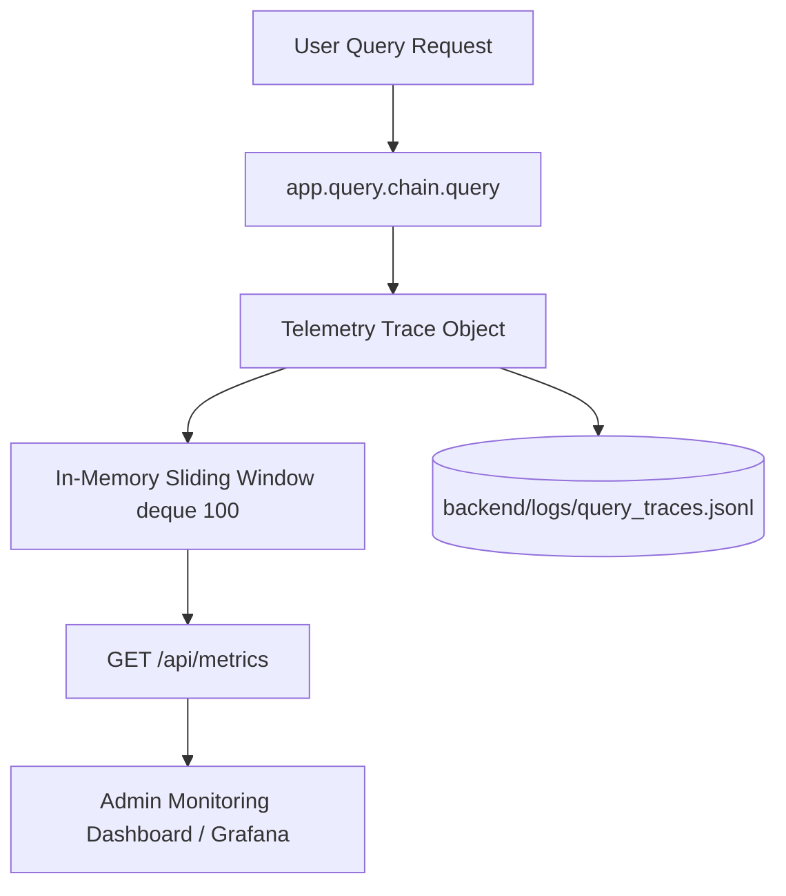

# Phase 23 Documentation: Observability & Tracing Architecture

**Date:** 2026-10-18  
**Scope:** Production observability, structured trace logging, latency telemetry, and operational monitoring  
**Implemented Modules:**
- Structured Telemetry Engine: [`backend/app/telemetry.py`](../../backend/app/telemetry.py)
- Metrics Endpoint: `GET /api/metrics` in [`backend/app/main.py`](../../backend/app/main.py)
- Trace Log Sink: `backend/logs/query_traces.jsonl`

---

## 1. Observability Architecture Overview

The UniAssist production pipeline captures end-to-end telemetry across every query transaction without introducing external SaaS dependencies or blocking user response generation.



---

## 2. Telemetry Schema & Payload

Each query generates a unique UUID-keyed trace record structured as follows:

```json
{
  "trace_id": "f81d4fae-7dec-11d0-a765-00a0c91e6bf6",
  "timestamp": "2026-10-18T09:26:00.123456+00:00",
  "client_ip": "127.0.0.1",
  "question": "What are the Central Library timings on Sunday?",
  "search_query": null,
  "was_rewritten": false,
  "model_used": "gemini-3.6-flash",
  "llm_role": "primary",
  "has_llm": true,
  "candidates_retrieved": 20,
  "candidates_reranked": 5,
  "candidates_compressed": 2,
  "sources": [
    "LibraryPolicy/Library Policy.pdf"
  ],
  "answer_length_chars": 245,
  "timings_ms": {
    "rewriter": 0.0,
    "retrieval": 42.5,
    "reranking": 585.1,
    "compression": 0.4,
    "generation": 3410.2,
    "total": 4038.2
  }
}
```

---

## 3. Real-Time Operational Endpoint: `GET /api/metrics`

The system exposes a lightweight, zero-dependency aggregation endpoint for health checks and dashboards:

### Response Payload:
```json
{
  "recent_window_queries": 100,
  "latency_ms": {
    "p50_total": 4120.5,
    "p95_total": 5210.0,
    "mean_total": 4250.3,
    "mean_generation": 3520.1,
    "mean_retrieval": 45.2,
    "mean_reranking": 612.4
  },
  "query_routing": {
    "rewritten_ratio": 0.180,
    "primary_model_ratio": 0.970,
    "fallback_model_ratio": 0.030,
    "extractive_fallback_ratio": 0.000
  },
  "latest_trace_id": "f81d4fae-7dec-11d0-a765-00a0c91e6bf6"
}
```

---

## 4. Key Operational Alerts & Thresholds

| Metric | Normal Range | Warning Threshold | Critical Incident Threshold | Recommended Remediation |
| :--- | :---: | :---: | :---: | :--- |
| **P95 Latency** | $< 5.5\text{ s}$ | $> 7.0\text{ s}$ | $> 12.0\text{ s}$ | Cohere API latency spike or primary LLM quota exhaustion. Failover activates automatically. |
| **Fallback LLM Ratio** | $< 2\%$ | $> 5\%$ | $> 20\%$ | Gemini 3.6 Flash rate-limiting or quota depletion; inspect Google API console. |
| **Extractive Ratio** | $0\%$ | $> 1\%$ | $> 5\%$ | All configured LLMs failed; check outbound network access and API credentials. |
| **Retrieval Drop** | 20 candidates | $< 10$ candidates | 0 candidates | ChromaDB index disconnect or empty collection. |
| **Compression Rate** | 2–4 chunks | 1 chunk | 0 chunks | Reranker score collapse; review document indexing. |
