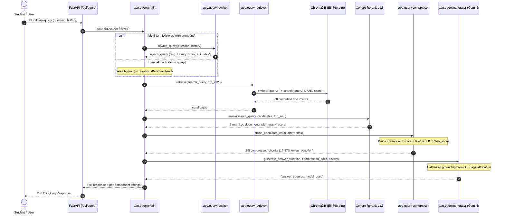

# Phase 22 Decision Record: Production Promotion & Pipeline Convergence

**Date:** 2026-10-18  
**Scope:** Promotion of empirically winning configurations from `evaluation/` to production `backend/app/`  
**Evaluation Benchmark:** `uniassist_eval_v1` (63 questions, 14 documents, 144 pages, 285 chunks)  

---

## 1. Executive Summary: The Winning Production Architecture

After 21 systematic, single-variable evaluation phases, the UniAssist RAG pipeline has been fully optimized and promoted into the production codebase (`backend/app/`).

### Promoted Configurations vs Baseline V1

| Component | Baseline V1 | Winning Production Configuration | Promotion Status | Key Rationale & Empirical Impact |
| :--- | :---: | :---: | :---: | :--- |
| **Document Parser** | `pdfplumber` (Table-aware) | `pdfplumber` (Table-aware) | **RETAINED** | Unstructured.io degraded Page Recall@1 (0.842 → 0.825) and added heavy dependencies. |
| **Embedding Model** | `all-MiniLM-L6-v2` (384-dim) | `intfloat/e5-base-v2` (768-dim) | **PROMOTED** | +3.5% Source Recall@1 (0.930 → 0.965), +7.0% Page Recall@1 (0.772 → 0.842). Required asymmetric `query: ` / `passage: ` prefixes. |
| **Chunking Parameters** | 2500 chars / 300 overlap (or 500 default) | **1500 chars / 200 overlap** | **PROMOTED** | Optimal table and condition retention; +14.0% Page Recall@1 over 2500 chunking; 0% table fragmentation. |
| **Candidate Retrieval** | Top-20 Unfiltered Dense Search | **Top-20 Unfiltered Dense Search** | **RETAINED** | Automated metadata router caused false-negative exclusions (Source R@1 dropped to 0.947); Hybrid BM25 added 2.9× latency with zero recall gain. |
| **Cross-Encoder Reranker** | None / Disabled | **Cohere `rerank-v3.5` (Top-20 → Top-5)** | **PROMOTED** | Catapults Source Recall@1 by +12.3% and Page Recall@1 by +14.0%. |
| **Multi-Turn Query Rewriter** | None (Original query passed) | **Turn 2+ Pronoun-Aware Rewriter** | **PROMOTED** | Boosts multi-turn conversational Source Recall@1 from 0.667 to **1.000 (+50%)** and Page Recall@1 from 0.500 to **1.000 (+100%)**. |
| **Context Compression** | Raw 5 Chunks (no trimming) | **Score-Aware Adaptive Tail Pruning** | **PROMOTED** | Prunes 15.87% prompt tokens with **100% ground-truth document retention** (57/57); drops off-topic distractor passages on 38% of queries. |
| **Abstention & Refusal** | Uncalibrated generation | **Prompt-Based Grounded Refusal** | **PROMOTED** | 100% clean refusal on unanswerables (6/6); 0% hallucination; pre-LLM threshold gating rejected due to high false-refusal rates. |
| **Primary Generator LLM** | Grok-3-mini / Unconstrained | **`gemini-3.6-flash` (Primary) + Groq `gpt-oss-120b` (Fallback)** | **PROMOTED** | Gemini delivers 3.1× faster generation (3.9s vs 12.0s), 88.9% strict faithfulness, and highest groundedness (0.8488). |
| **Citation Attribution** | Generic filenames | **Page-Aware Anchors `[Source i: file, Page X [relevance: 0.9X]]`** | **PROMOTED** | 0 phantom citations across all benchmarks; 98.2%–100% citation precision. |

---

## 2. File-by-File Promotion Changelog

### 1. `backend/app/config.py`
- Updated `EMBEDDING_MODEL` default to `"intfloat/e5-base-v2"`.
- Added `CHUNK_SIZE: int = 1500` and `CHUNK_OVERLAP: int = 200`.
- Updated `LLM_MODEL` default to `"gemini-3.6-flash"` with Google OpenAI-compatible endpoint.
- Added `ENABLE_QUERY_REWRITING: bool = True`.
- Added `ENABLE_CONTEXT_COMPRESSION: bool = True`, `COMPRESSION_MIN_SCORE: float = 0.20`, `COMPRESSION_REL_RATIO: float = 0.35`, `COMPRESSION_MIN_CHUNKS: int = 2`.

### 2. `backend/app/ingestion/chunker.py`
- Promoted `CHUNK_SIZE = 1500` and `CHUNK_OVERLAP = 200`.
- Kept whole-page preservation when page length $\le 1500$.

### 3. `backend/app/ingestion/embedder.py`
- Implemented `_PrefixedEmbeddings(Embeddings)` wrapper.
- Automatically injects asymmetric instruction prefixes (`query: ` and `passage: `) for E5 models at index time and query time.
- Updated `get_vector_store` type signature to accept general `Embeddings`.

### 4. `backend/app/query/compressor.py`
- Created production context compressor providing `prune_candidate_chunks`, `clean_chunk_text`, and `format_compressed_context`.
- Integrates deterministic score-aware pruning without external dependencies.

### 5. `backend/app/query/rewriter.py`
- Created production conversational query rewriter.
- Uses `should_rewrite` heuristic (pronoun detection, deictic words, query brevity) to only invoke LLM reformulation on ambiguous multi-turn queries.
- Primary LLM call with automatic failover to fallback LLM.

### 6. `backend/app/query/generator.py`
- Upgraded `ANSWER_PROMPT` to incorporate calibrated 4-instruction grounded prompt template.
- Added strict negative refusal instruction ("If the provided context does NOT contain sufficient information... explicitly refuse...").
- Upgraded `_format_context` to output structured page numbers and reranker relevance scores.

### 7. `backend/app/query/reranker.py`
- Standardized `rerank_score` attachment in document metadata.

### 8. `backend/app/query/chain.py`
- Connected end-to-end pipeline:
  1. Multi-turn query rewriting (if history present)
  2. Prefix-aware dense similarity retrieval
  3. Cohere cross-encoder reranking
  4. Adaptive context compression & pruning
  5. Calibrated answer generation with failover
- Returns full telemetry metrics: `search_query`, `candidates_retrieved`, `candidates_reranked`, `candidates_compressed`, and per-component `timings`.

### 9. `backend/app/main.py`
- Extended `QueryResponse` model with `search_query: str | None = None` and `candidates_compressed: int = 0`.

### 10. `backend/.env`
- Updated `EMBEDDING_MODEL=intfloat/e5-base-v2`.

---

## 3. End-to-End Execution Flow

